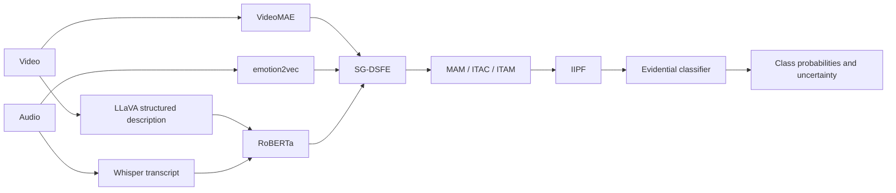

# MSE-IIPF

**Modality-Transformed Affective Semantic Enhancement and Implicit Internal-State Proxy Fusion for Multimodal Emotion Recognition**

[Repository](https://github.com/jungeniubi725/MSE-IIPF) · [Releases](https://github.com/jungeniubi725/MSE-IIPF/releases) · [Method ↔ code](docs/METHOD_CODE_MAP.md) · [Data and models](docs/DATA_AND_MODELS.md) · [Experiments and figures](docs/EXPERIMENTS.md)

This repository packages the research implementation of MSE-IIPF: semantic-guided dual-stream feature enhancement (SG-DSFE), tri-modal affective alignment, implicit internal-state proxy learning and fusion (IIPF), and evidential emotion classification. It contains source code, configuration files and tests. Datasets, pretrained weights, extracted features and historical experimental results are downloaded or generated separately.

## Implemented workflows

| Dataset | Implemented input and model | Evaluation unit |
| --- | --- | --- |
| RAVDESS | Raw audio/video → LLaVA/Whisper text → VideoMAE/emotion2vec/RoBERTa features → SG-DSFE → MAM/ITAC/ITAM → IIPF → evidential head | Original audio/video sequence; segment metrics are also saved |
| CMU-MOSI | Released openSMILE, GloVe and FACET features → tri-modal ALBEF alignment → IIPF → evidential head | Utterance |
| CMU-MOSEI | Released COVAREP, GloVe and FACET features → tri-modal ALBEF alignment → IIPF → evidential head | Utterance |

The two CMU experiments bypass SG-DSFE and use their original ALBEF alignment implementation. They are complementary feature-based experiments. The default evidential calibration loss uses a hard prediction-error target; the manuscript describes a conflict target. These distinctions, additional loss terms and formula mappings are documented in [Method ↔ code](docs/METHOD_CODE_MAP.md). This release does not claim to reproduce every manuscript table numerically.



## Installation

Use **Python 3.12** (supported range: 3.11–3.12). Clone the repository with an authorized GitHub account, or extract the source archive:

```bash
git clone https://github.com/jungeniubi725/MSE-IIPF.git
cd MSE-IIPF
```

Run the following commands from the repository root:

```bash
python -m venv .venv
```

Activate with `source .venv/bin/activate` on Linux/macOS, or `.venv\Scripts\Activate.ps1` in Windows PowerShell. For a CPU software check:

```bash
python -m pip install --upgrade pip
python -m pip install torch==2.8.0 --index-url https://download.pytorch.org/whl/cpu
python -m pip install -r requirements.txt
python -m pytest -q
python scripts/smoke_test.py --device cpu
```

The smoke test trains on tiny random fixtures, reloads the checkpoint, evaluates held-out fixtures, and produces figures. Its numbers are software checks, not research results. No dataset or pretrained weight download is required for this check.

For full feature extraction, install the CUDA build appropriate for your machine, the optional extraction dependencies, FFmpeg/ffprobe, and the LLaVA backend. See [environment setup](docs/DATA_AND_MODELS.md#environment). The CUDA 12.8 package versions matching the inspected environment are listed in the [official PyTorch instructions](https://pytorch.org/get-started/previous-versions/#v280).

## RAVDESS: download and prepare

The downloader selects the audio and audio-video files from the [official RAVDESS release](https://zenodo.org/records/1188976), checks the supplied archive checksums, and organizes them by actor. Review the download plan first if needed:

```bash
python scripts/download_data.py --dataset ravdess --dry-run
python scripts/download_models.py --models all --dry-run
python scripts/download_data.py --dataset ravdess
python scripts/download_models.py --models all
python scripts/s0_scan.py --dataset ravdess --root data/ravdess --out cache/ravdess/manifest.csv --num-segments 4 --probe-duration
```

Generate structured visual descriptions and speech transcripts, then extract the four feature branches:

```bash
python scripts/s1_gen_text.py --manifest cache/ravdess/manifest.csv --task caption --backend llava_next --quant int8 --out cache/ravdess/text/captions.jsonl
python scripts/s1_gen_text.py --manifest cache/ravdess/manifest.csv --task asr --out cache/ravdess/text/asr.jsonl
python scripts/s2_extract_feats.py --manifest cache/ravdess/manifest.csv --mod visual --out-dir cache/ravdess/feats
python scripts/s2_extract_feats.py --manifest cache/ravdess/manifest.csv --mod audio --out-dir cache/ravdess/feats
python scripts/s2_extract_feats.py --manifest cache/ravdess/manifest.csv --mod text --out-dir cache/ravdess/feats --caption-jsonl cache/ravdess/text/captions.jsonl --asr-jsonl cache/ravdess/text/asr.jsonl
```

Model locations default to `weights/`. Each extractor accepts a path override; existing local downloads can be reused. Text generation and feature extraction skip completed items. Failed or dummy text records are rejected before feature extraction.

## RAVDESS: train, test and retain predictions

Train and select the checkpoint using validation data:

```bash
python scripts/s3_train.py --config configs/ravdess.yaml --exp-name ravdess_main --validation-only
```

Evaluate the selected checkpoint on the test split in a separate command:

```bash
python scripts/evaluate.py --checkpoint runs/ravdess_main/best.pt --split test --out-dir runs/ravdess_main/test
python scripts/plot_results.py --predictions runs/ravdess_main/test/test_predictions.npz --level sequence --out-dir figures/ravdess_main --history runs/ravdess_main/history.json --class-names neutral calm happy sad angry fearful disgust surprised
```

Omitting `--validation-only` from training evaluates the test set once after validation-based checkpoint selection. Use a new experiment name for each new run. An existing checkpoint is not silently overwritten; `evaluate.py` performs inference only.

For the retained five-fold protocol and multiple seeds:

```bash
python scripts/run_experiments.py --cv --seeds 42 43 44 --variants main --validation-only
python scripts/run_experiments.py --cv --seeds 42 --variants no_mam no_itac no_itam no_iipf no_cmc no_tpc no_prr softmax no_cal --validation-only
python scripts/run_experiments.py --grid configs/hparam_grid.example.yaml --seeds 42 --dry-run
```

The CV folds test Actors 01–20 in five groups; Actors 21–22 remain validation and Actors 23–24 are reserved for the fixed-split test. This is not a five-fold partition of all 24 actors. Grids always use validation only. See [experiment commands](docs/EXPERIMENTS.md) before final testing.

## CMU-MOSI and CMU-MOSEI

Download the official feature releases and split definitions, then convert CSD files to CSV:

```bash
python scripts/download_data.py --dataset mosi
python scripts/prepare_cmu.py --csd-dir data/cmu_mosi/csd --out-dir data/cmu_mosi
python scripts/run_cmu.py --dataset mosi --stage align --seed 42
python scripts/run_cmu.py --dataset mosi --stage train --seed 42
python scripts/run_cmu.py --dataset mosi --stage evaluate --seed 42
```

For MOSEI, replace `mosi` with `mosei` in those commands. Alignment is trained afresh for each seed. `--stage train` evaluates validation only; `--stage evaluate` reloads the saved classifier and exports test predictions. `--stage all` runs preparation, alignment, training and final evaluation together.

The retained classification protocol has **three** classes: negative for scores ≤ −0.5, neutral for −0.5 < score < 0.5, and positive for scores ≥ 0.5. It must not be compared directly with two-class, seven-class or regression scores. Feature normalization is fitted using the official training split.

```bash
python scripts/plot_results.py --predictions runs/cmu_mosi/seed42/main/test_predictions.npz --level unit --class-names Negative Neutral Positive --out-dir figures/cmu_mosi
python scripts/summarize_results.py --runs runs --split test --out tables/test_metrics.csv
```

The CMU downloader uses the URLs published by the [CMU Multimodal SDK](https://github.com/CMU-MultiComp-Lab/CMU-MultimodalSDK). If its upstream file server is unavailable, use an authorized mirror via `--cmu-base-url`, or existing official CSD/CSV files. It never substitutes another dataset silently.

## Saved artifacts

| File | Content |
| --- | --- |
| `best.pt` | Selected model state and effective training configuration |
| `config.json`, `environment.json` | Run settings and package/device information; CMU environment metadata is stored at seed level |
| `history.json` | Training and validation history |
| `validation_metrics.json`, `test_metrics.json` | Classification, per-class, calibration, uncertainty and agreement metrics |
| `*_predictions.npz` | Labels, probabilities, predictions, uncertainty and stable sample IDs; CMU also retains video IDs and timestamps |
| `*_unit_predictions.csv`, `*_sequence_predictions.csv` | Human-readable predictions; sequence exports apply to RAVDESS |
| Figure directory | PNG/SVG/PDF panels plus CSV source data and recomputed metrics |

Unavailable statistics are reported as `null` in the new JSON exports. The full prediction arrays remain available for independent recomputation.

## Repository layout

```text
MERC-GitHub/
├── configs/                 # RAVDESS configuration and example hyperparameter grid
├── src/
│   ├── data/                # Manifest, actor splits, feature loading and collation
│   ├── extractors/          # LLaVA, Whisper, VideoMAE, emotion2vec and RoBERTa
│   ├── models/              # SG-DSFE, TMA, IIPF, evidence head and CMU ALBEF
│   ├── losses/              # Contrastive, divergence and consistency objectives
│   ├── engine/              # Training and evaluation
│   └── metrics/             # Classification, calibration and agreement
├── experiments/cmu/        # Original distinct MOSI/MOSEI implementations
├── scripts/                # Download, prepare, train, test, export, plot and package
├── tests/                  # Numerical, split, export and pipeline checks
├── docs/                   # Protocols, formula mappings and release instructions
├── licenses/               # Retained third-party notice
└── .github/workflows/       # CPU test workflow
```

`data/`, `weights/`, `cache/`, `runs/`, `figures/`, and `tables/` are created locally and excluded from version control and release archives.

## Figures and reproducibility

`plot_results.py` produces confusion matrices, calibration curves, risk–coverage curves, uncertainty histograms and optional training curves from saved predictions. Original feature, fusion and waveform plotting scripts are also retained. See [figure commands and interpretation](docs/EXPERIMENTS.md#figures).

See [validation scope](docs/VALIDATION.md) for the checks performed on this release. Full GPU training and numerical reproduction of the manuscript tables are separate experiments and were not rerun while packaging.

## Help, citation and license

For a reproducibility issue, provide the command, effective configuration, package versions and traceback in the repository's Issues tab. Project maintenance is handled by the repository owner and paper authors.

The paper title is given above. Author names, publication venue and DOI were not assigned by this packaging process; a bibliographic citation should be added when those details are finalized. No new license for the authors' code is imposed in this release. Existing third-party notices are retained in [THIRD_PARTY_NOTICES.md](THIRD_PARTY_NOTICES.md).

## Create and upload a source archive

```bash
python scripts/package_release.py --output dist/MERC-GitHub-source.zip
```

This builds an allowlisted source archive, adds file hashes and writes a ZIP SHA-256 sidecar. Follow [GitHub upload instructions](docs/RELEASING.md) to expose the README and source files in the repository and attach the ZIP as a Release asset.

For ongoing commits, synchronization and version management in Git Bash, see [GIT_WORKFLOW.md](docs/GIT_WORKFLOW.md).

